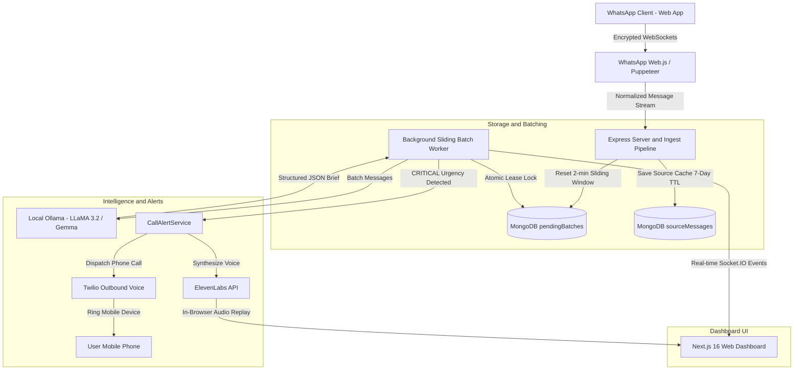

# ⚡ Client Buddy

> **Privacy-First, Local-First AI Client Intelligence & Outbound Call Alert Platform for Freelancers, Agencies, and Consultants.**

[](https://nextjs.org/)
[](https://react.dev/)
[](https://www.typescriptlang.org/)
[](https://tailwindcss.com/)
[](https://www.mongodb.com/)
[](https://ollama.com/)
[](https://github.com/pedroslopez/whatsapp-web.js)
[](https://elevenlabs.io/)
[](https://www.twilio.com/)

---

## 📖 Table of Contents
- [Executive Overview](#-executive-overview)
- [Key Architectural Pillars](#-key-architectural-pillars)
- [System Architecture](#-system-architecture)
- [Core Features](#-core-features)
- [Emergency Call Alerts (ElevenLabs + Twilio)](#-emergency-call-alerts-elevenlabs--twilio)
- [Monorepo Structure](#-monorepo-structure)
- [Getting Started & Installation](#-getting-started--installation)
- [Configuration & Environment Variables](#-configuration--environment-variables)
- [How to Use Client Buddy](#-how-to-use-client-buddy)
- [API Reference](#-api-reference)
- [Privacy, Compliance & GDPR Zero-Footprint](#-privacy-compliance--gdpr-zero-footprint)
- [Troubleshooting & FAQ](#-troubleshooting--faq)

---

## 🎯 Executive Overview

Freelancers and digital agencies face a universal challenge: **client communication is fragmented and chaotic**. Clients rarely send structured project briefs over email; instead, they send rapid-fire bursts of 5 to 15 fragmented WhatsApp messages across minutes or hours.

**Client Buddy** bridges this gap:
1. **Captures live WhatsApp message streams** via an authenticated headless WhatsApp Web session.
2. **Aggregates fragmented bursts** using an intelligent **Sliding-Window Batching Engine** (inactivity quiet window).
3. **Processes text locally on your hardware** using **Ollama** (open-weight LLaMA 3.2 or Gemma models) — **100% private, zero cloud LLM exposure**.
4. **Synthesizes structured Client Briefs**: urgency assessment, explicit deliverables, hard deadlines, identified ambiguities, and tone-matched suggested reply drafts.
5. **Triggers ElevenLabs Outbound Phone Call Alerts** to your mobile phone when a high-stakes **`CRITICAL`** outage or emergency is detected.
6. **Strict "Zero Auto-Reply" Policy**: The application **never** contacts clients automatically. You retain complete human discretion with single-click manual copy-paste reply drafts.

---

## 🏛 Key Architectural Pillars

### 1. Sliding-Window Batching Engine
* **The Problem**: Clients send consecutive messages (*"Hey"*, *"Quick update"*, *"The cart is broken"*, *"Can you fix before 5 PM?"*). If analyzed individually, each message generates fragmented, disjointed summaries.
* **The Solution**: 
  - Each incoming message resets a 2-minute sliding inactivity countdown (`flushAt`).
  - A hard upper limit (`maxFlushAt`, 10 minutes) ensures that continuous chat bursts are never delayed indefinitely.
  - Multi-worker scalability is secured via atomic MongoDB lease locks (`findOneAndUpdate`), guaranteeing **exactly-once** processing.

### 2. Privacy-First Local AI Engine (Ollama)
* All message analysis is executed on your local GPU/CPU via [Ollama](https://ollama.com/) running open-weight models (`llama3.2:latest` or `gemma:2b`).
* Client NDA data, proprietary credentials, and sensitive conversation histories **never** leave your machine for analysis.

### 3. Outbound Phone Call Alerts (ElevenLabs + Twilio)
* When incoming client bursts report severe incidents (e.g., payment failures, live site crashes, emergency blocks), the system marks the incident as **`CRITICAL`**.
* The server synthesizes natural voice audio via **ElevenLabs** and initiates an outbound voice call via **Twilio** directly to your phone.

---

## 📐 System Architecture



---

## 🚀 Core Features

### 1. Live WhatsApp Web Ingestion
* **QR-Code Pairing**: Seamless pairing via browser QR scanner with authentic `whatsapp-web.js` + Puppeteer backend.
* **Persistent Authentication**: Session tokens are preserved locally in `.wwebjs_auth/session`. The server automatically reconnects on reboot without re-scanning.
* **Open in WhatsApp Web**: Every contact card includes a direct link to open the conversation directly in WhatsApp Web.

### 2. Selective vs. All-Contacts Monitoring
* **All Contacts (Open Mode)**: Ingests messages from anyone who contacts you on WhatsApp (including new numbers and group chats). New contacts are automatically discovered, registered, and sorted dynamically.
* **Selective (Whitelist Mode)**: Processes bursts *strictly* from contacts explicitly added to your monitored contacts list. Unmonitored messages are safely ignored.
* **Manual Contact Creation**: Add any custom number (with automatic E.164 normalization, e.g., `+91 98765 43210` $\rightarrow$ `919876543210@c.us`).

### 3. Smart Dynamic Contacts Sorting
* The sidebar Contacts List dynamically sorts contacts in real time according to the **timestamp of the latest message sent or received**.
* Just like WhatsApp, the contact who sent the most recent message immediately moves to the top of the list.
* Contact cards display formatted activity badges (`10:45 AM`, `Yesterday`, `Oct 14`), contact names, group badges, and text snippets.

### 4. Client Context Profiling
* Tailor intelligence per client:
  * **Project Scope Definition**: Outline agreed deliverables (e.g. *"Stripe checkout flow & dashboard integration only"*). Out-of-scope requests are automatically flagged.
  * **Preferred Tone Matching**: Configure response style (*"Concise and technical"*, *"Warm and consultative"*, *"Firm on deadlines"*).
  * **Urgency Sensitivity**: Custom thresholds per client.

### 5. Structured Client Briefs
Each aggregated brief card provides:
* **Executive Summary**: A concise 2-sentence operational digest.
* **Urgency Badge**: Color-coded urgency (`LOW`, `NORMAL`, `HIGH`, `CRITICAL`) with AI evidence justification.
* **Explicit Deliverables**: Extracted checklist of specific requests.
* **Deadlines**: Temporal deadlines identified from natural conversation (e.g., *"Friday by 5 PM"*, *"Tomorrow morning"*).
* **Open Questions**: Clarifications you need to ask the client before proceeding.
* **Action Items**: Next steps ready to check off.
* **Suggested Reply**: One-click manual copy-paste reply draft matching your client's preferred tone.
* **Source Inspector Drawer**: Audit every raw message that contributed to the summary.

### 6. Automated Reminders & Deadline Tracking
* Actionable deadlines are automatically converted into reminder candidates.
* Status tracking: `Upcoming`, `Completed`, `Overdue`, and `Needs Confirmation`.
* Filterable view with single-click completion toggle.

### 7. Daily Executive Standup Digest
* Aggregates metrics: total briefs, active clients, critical incidents, and active deadlines today.
* Automatically synthesizes a markdown **Daily Standup Report** ready to paste into Slack, Notion, or email.

---

## 🚨 Emergency Call Alerts (ElevenLabs + Twilio)

For high-stakes incidents where missing a WhatsApp message could cost a client relationship or revenue:

1. **Trigger Condition**: An incoming burst is evaluated by the local model as **`CRITICAL`** (e.g., server crash, payment gateway down, 500 errors).
2. **ElevenLabs Realistic Audio Generation**:
   * Uses ElevenLabs' `eleven_multilingual_v2` model to synthesize crystal-clear, natural speech.
   * Example announcement:
     > *"Critical alert from Client Buddy: A high-priority emergency was reported by your client, Aarav Sharma. Production payment gateway outage reported on checkout page. Please review your dashboard immediately."*
   * Includes automated fallback to premade voices (`EXAVITQu4vr4xnSDxMaL` - Sarah) ensuring zero downtime on free-tier ElevenLabs plans.
3. **Outbound GSM / PSTN Phone Call via Twilio**:
   * Twilio dials your personal mobile number (`ALERT_PHONE_NUMBER`).
   * When you answer, Twilio reads or streams the emergency audio directly to your ear.
4. **Interactive Dashboard Banner**:
   * Pulsing emergency banner displayed at the top of the dashboard.
   * In-browser audio player with instant **Replay Voice Briefing** button.
   * One-click **"Test 11Labs Call"** button in the top navigation bar to test the pipeline anytime.

---

## 📂 Monorepo Structure

```text
BusinessBuddy/
├── apps/
│   ├── server/                         # Express & Background Engine
│   │   ├── src/
│   │   │   ├── ai.ts                  # Ollama local inference & prompt engineering
│   │   │   ├── batching.ts            # Sliding-window quiet window manager
│   │   │   ├── callAlert.ts           # ElevenLabs TTS & Twilio outbound calling service
│   │   │   ├── db.ts                  # MongoDB connection & index definitions
│   │   │   ├── server.ts              # REST API & Socket.IO server
│   │   │   ├── whatsapp.ts            # WhatsApp Web.js / Puppeteer lifecycle manager
│   │   │   └── worker.ts              # Sliding-window batch worker
│   │   ├── .env                       # Server configuration & API keys
│   │   ├── package.json
│   │   └── tsconfig.json
│   │
│   └── web/                            # Next.js 16 Web Dashboard
│       ├── src/
│       │   ├── pages/
│       │   │   ├── index.tsx          # Unified Client Buddy interface
│       │   │   └── _app.tsx
│       │   └── styles/
│       │       └── globals.css
│       ├── package.json
│       └── tsconfig.json
│
├── packages/
│   └── shared/                         # Shared Types & Zod Schemas
│       ├── src/
│       │   └── index.ts               # UrgencyLevel, ContactPreference, Brief schemas
│       ├── package.json
│       └── tsconfig.json
│
├── package.json                        # Root workspace configuration
└── README.md
```

---

## 🛠 Getting Started & Installation

### Prerequisites
* **Node.js**: `v18.0.0` or higher (Node 20+ recommended)
* **MongoDB**: Running locally at `mongodb://127.0.0.1:27017`
* **Ollama**: Installed and running locally ([Download Ollama](https://ollama.com/))
  ```bash
  # 1. Start Ollama local inference engine (if not already running in background / system tray)
  ollama serve

  # 2. Pull the default local model
  ollama pull llama3.2:latest
  # (Alternative lightweight model)
  ollama pull gemma:2b
  ```
* **Google Chrome**: Installed on your system (used by Puppeteer for WhatsApp Web).

---

### Step 1: Clone and Install Dependencies

```bash
git clone https://github.com/your-username/BusinessBuddy.git
cd BusinessBuddy

# Install dependencies across all monorepo workspaces
npm install
```

### Step 2: Build Shared Packages

```bash
npm run build --workspace=packages/shared
```

### Step 3: Configure Environment Variables

Create or review `apps/server/.env`:

```env
PORT=3001
HOST=127.0.0.1
MONGODB_URI=mongodb://127.0.0.1:27017/clientpulse
OLLAMA_BASE_URL=http://127.0.0.1:11434
OLLAMA_MODEL=llama3.2:latest
JWT_SECRET=your_jwt_secret_key_here

# ElevenLabs Call Alert Configuration
ELEVENLABS_API_KEY=your_elevenlabs_api_key_here
ELEVENLABS_VOICE_ID=EXAVITQu4vr4xnSDxMaL
ELEVENLABS_AGENT_ID=

# Outbound Phone Calling (Twilio / GSM)
TWILIO_ACCOUNT_SID=your_twilio_account_sid_here
TWILIO_AUTH_TOKEN=your_twilio_auth_token_here
TWILIO_PHONE_NUMBER=your_twilio_phone_number_here
ALERT_PHONE_NUMBER=+918091983263
```

### Step 4: Run the Application

#### Terminal 1 — Start Ollama (if not already running in background / system tray):
```bash
ollama serve
```
*(Runs the local open-weight AI inference server at `http://127.0.0.1:11434`).*

#### Terminal 2 — Start the Backend Server & Sliding-Window Batch Worker:
```bash
npm run dev:server
```
*(Runs at `http://127.0.0.1:3001` and connects to MongoDB, Ollama, and your live WhatsApp Web session).*

#### Terminal 3 — Start the Next.js Web Dashboard:
```bash
npm run dev:web
```
*(Available at `http://localhost:3000`).*

---

## ⚙️ Configuration & Environment Variables

| Variable | Description | Default |
|---|---|---|
| `PORT` | Backend HTTP API port | `3001` |
| `MONGODB_URI` | MongoDB connection connection string | `mongodb://127.0.0.1:27017/clientpulse` |
| `OLLAMA_BASE_URL` | Local Ollama HTTP endpoint | `http://127.0.0.1:11434` |
| `OLLAMA_MODEL` | Local inference model name | `llama3.2:latest` |
| `JWT_SECRET` | Secret key for JWT session tokens | `clientpulse_secret_key_2026` |
| `ELEVENLABS_API_KEY` | ElevenLabs API key for voice synthesis | `sk_...` |
| `ELEVENLABS_VOICE_ID` | Voice identifier (`EXAVITQu4vr4xnSDxMaL` = Sarah) | `EXAVITQu4vr4xnSDxMaL` |
| `ELEVENLABS_AGENT_ID` | *(Optional)* Conversational AI Agent ID | `""` |
| `TWILIO_ACCOUNT_SID` | *(Optional)* Twilio Account SID for phone calls | `AC...` |
| `TWILIO_AUTH_TOKEN` | *(Optional)* Twilio Auth Token | `...` |
| `TWILIO_PHONE_NUMBER` | *(Optional)* Outbound Twilio caller ID | `+1...` |
| `ALERT_PHONE_NUMBER` | Destination mobile phone to receive alert calls | `+91...` |

> [!TIP]
> **Twilio Free Trial Note**: If using a Twilio Trial account, remember to add your destination phone number (`ALERT_PHONE_NUMBER`) to **Twilio Console $\rightarrow$ Phone Numbers $\rightarrow$ Verified Caller IDs** so Twilio permits outbound calls.

---

## 📱 How to Use Client Buddy

### 1. Link Your WhatsApp
1. Open the dashboard at [http://localhost:3000](http://localhost:3000).
2. Register or log in to your local account.
3. If not already paired, click **Link WhatsApp Device** to generate an authentic WhatsApp QR code.
4. On your mobile phone, open **WhatsApp $\rightarrow$ Linked Devices $\rightarrow$ Link a Device** and scan the screen.
5. Your WhatsApp session is authenticated and persisted locally in `.wwebjs_auth/session`.

### 2. Choose Your Monitoring Strategy
* Use the toggle in the left sidebar to select:
  * **All Contacts (Open)**: Recommended for freelancers who receive inquiries from new potential clients.
  * **Selective (Whitelist)**: Recommended for agencies managing designated VIP client accounts only.

### 3. Add & Customize Contacts
* Click **"+ Add New Contact"** in the sidebar.
* Enter client phone number (e.g. `+91 80919 83263`), display name, and project scope.
* Use the ⚙️ icon to adjust client tone preferences and scope boundaries at any time.

### 4. Experience Automatic Burst Processing
* Have a client send multiple messages over WhatsApp.
* An interactive banner appears: `Live Message Received: (Quiet window active)`.
* Each new message resets the 2-minute timer.
* Click **"Analyze Now"** to immediately skip the timer and trigger analysis, or simply let the quiet window expire.
* The synthesized brief card appears in your **Client Brief Feed**.

### 5. Review & Respond
* Read the synthesized requirements and deadlines.
* Click the **Copy** button on the **Suggested Reply** box and paste it directly into WhatsApp Web.
* Check off completed deliverables in your **Reminders & Deadlines** tab.

---

## 📡 API Reference

### Authentication
* `POST /api/auth/register` — Create local user account.
* `POST /api/auth/login` — Authenticate and receive JWT token.
* `GET /api/auth/me` — Retrieve active profile and settings.
* `PUT /api/user/monitoring-mode` — Toggle between `'all'` and `'selective'` mode.

### WhatsApp Device Management
* `POST /api/whatsapp/request-qr` — Initialize client and generate pairing QR data URL.
* `POST /api/whatsapp/disconnect` — Disconnect active Puppeteer browser session.

### Contacts Management
* `GET /api/contacts` — Retrieve contacts list sorted descending by latest message activity.
* `POST /api/contacts` — Register new contact with scope & tone profile.
* `PUT /api/contacts/:chatId` — Update contact monitoring status or scope profile.
* `DELETE /api/contacts/:chatId` — Delete contact from monitored list.

### Briefs & Reminders
* `GET /api/summaries` — Retrieve list of synthesized briefs (optional `chatId` query param).
* `GET /api/reminders` — Retrieve extracted reminders and deadlines.
* `PUT /api/reminders/:reminderId` — Mark reminder as `completed` or `upcoming`.
* `POST /api/mock/flush-now` — Immediately flush pending sliding window batch for instant analysis.

### ElevenLabs & Call Alerts
* `POST /api/alerts/test-call` — Manually trigger an ElevenLabs voice call alert test.
* `GET /api/alerts/:summaryId/audio` — Stream synthesized ElevenLabs MP3 audio briefing.

### GDPR, Privacy & Compliance
* `GET /api/data/export` — Export complete account data in JSON format.
* `DELETE /api/data/source-cache` — Immediately purge raw source inspection cache.
* `DELETE /api/data` — Complete wipe of all user data.

---

## 🔒 Privacy, Compliance & GDPR Zero-Footprint

Client Buddy is engineered from the ground up for strict privacy compliance:

1. **Local-Only Inference**: Prompts and messages are sent exclusively to your local Ollama instance (`http://127.0.0.1:11434`). No third-party LLM sees your clients' proprietary data.
2. **7-Day Automatic Message TTL**: Raw source messages stored in the `sourceMessages` collection are equipped with a native MongoDB TTL index (`expireAfterSeconds: 0`), automatically purging raw chat records after 7 days.
3. **Instant Cache Purge**: Single-click **"Shield"** button in the navbar purges the raw message inspection cache immediately.
4. **GDPR Data Portability**: Single-click **"Export Data"** downloads all briefs, reminders, and context profiles in portable JSON format.
5. **Human Discretion**: No automated replies are ever dispatched to WhatsApp. The system produces only suggested copy-paste drafts.

---

## ❓ Troubleshooting & FAQ

### Q: Why does WhatsApp say "Session auto-restore notice: The browser is already running"?
> **Solution**: If a previous server process didn't terminate cleanly, an orphaned Chrome instance may still be locking `.wwebjs_auth/session`. Run the following in PowerShell:
> ```powershell
> Get-Process chrome -ErrorAction SilentlyContinue | Where-Object { $_.CommandLine -like "*wwebjs*" } | Stop-Process -Force
> ```
> Then restart the server with `npm run dev:server`.

### Q: Why did ElevenLabs return "402: Free users cannot use library voices via API"?
> **Solution**: Free-tier ElevenLabs accounts cannot use custom/community voices from the Voice Library via API. Client Buddy automatically handles this by falling back to the default premade voice **Sarah** (`EXAVITQu4vr4xnSDxMaL`). You can also set `ELEVENLABS_VOICE_ID=pNInz6obpgDQGcFmaJgB` for **Adam**.

### Q: Why did Twilio return "Error 21219: The number is unverified"?
> **Solution**: Twilio Free Trial accounts require destination phone numbers to be verified before they can receive outbound calls. Open your [Twilio Console](https://console.twilio.com/) $\rightarrow$ **Phone Numbers** $\rightarrow$ **Verified Caller IDs** and verify your mobile number.

### Q: How do I test without waiting for the 2-minute quiet window?
> **Solution**:
> - If a real WhatsApp message arrives, click **"Analyze Now (Skip Wait)"** on the green live banner.
> - To test the ElevenLabs phone alert pipeline immediately, click **"Test 11Labs Call"** in the top navigation bar.

---

## 📄 License
MIT License. Built for freelancers and agencies who prioritize privacy and client focus.
